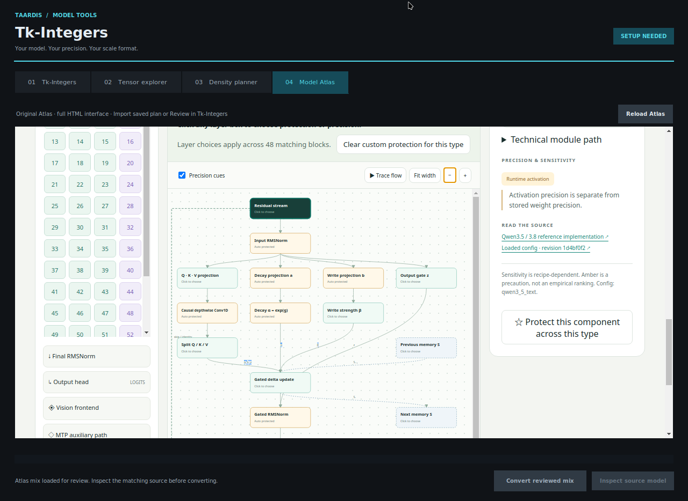

# Tk-Integers: Explicit Base-3 Containers and Model-Aware Quantization Recipes

**Cody Dixon · TAARDIS**

**Technical paper, version 1.0 · October 8, 2026**

**Implementation studied:** `CodeMasterCody3D/tkintegers`, commit
`4e3d91628302586c7a94d994641b391d656826c4` [6].
**Atlas source:** `CodeMasterCody3D/quant-test`, commit
`aea688d38e13bee505e608abf5125a8cef159682`, directory `qwen-atlas` [7].

This is a completed implementation and analytical study. Its evidence consists
of source inspection, exact storage calculations, recipe-validation tests and
interface integration checks. It does not report a new language-model quality,
training-memory or inference-speed benchmark. The distinction matters: a
complete description of a representation does not establish that every model
converted into it retains its capabilities.

## Abstract

Tk-Integers is a family of model-value representations designed by Cody Dixon
that combines balanced base-3 codes with explicit group scales and, for a
training-state variant, a carried quantization residual. We present a concrete
specification of the representations implemented in the standalone Tk-Integers
repository and a model-aware desktop interface for selecting them. A format is
identified by more than its trit depth: group geometry, scale encoding, stream
alignment and reconstruction arithmetic also determine its size and behavior.
We derive the byte counts of the implemented layouts, distinguishing tightly
packed trits, native-width integer codes, row packing and independently padded
groups. Five trits per byte give a nominal code cost of 1.6 bits per trit; k1
with one 12-bit scale per complete group of 20 weights gives 2.2 bits per weight.
However, padding and alignment can make two identically labelled k/group/scale
choices occupy different numbers of bytes. The application embeds the complete
Model Atlas HTML interface and transfers its exported per-layer recipes into a
checkpoint-matching review before conversion. Existing architecture tests,
new recipe tests and an actual HTML-to-desktop handoff support the software
integration claims. Model-quality preservation and packed-runtime performance
remain separate empirical questions.

**Keywords:** balanced ternary; model storage; group quantization; scale
quantization; mixed precision; error feedback; safetensors; model visualization.

## 1. Introduction

The phrase “a k-trit model” is an incomplete storage specification. It says how
many base-3 digits describe a weight code, but not how the digits are packed,
which weights share a scale, how the scale is stored, or which other tensors
remain at their original precision. It also says nothing about the arithmetic
used to reconstruct a tensor or execute a matrix multiplication. A compact
integer payload can be decoded into a larger floating-point working tensor.

Tk-Integers makes these choices explicit. A weight can use one or more balanced
trits, a group can contain fewer or more weights, and the associated scales can
use integer-anchor, logarithmic, ternary or floating-point encodings. These are
independent controls with different effects: adding trits increases code
resolution; reducing group size increases the number of independently fitted
scales; changing scale encoding changes the accuracy and cost of the scales.

The application combines this representation work with Model Atlas. Atlas
describes a selected Qwen text-decoder architecture, displays its data flow and
allows per-layer precision and protection choices. The desktop application
embeds the original HTML rather than reproducing a subset of it. An exported
recipe is subsequently matched to actual safetensors names and shapes before
the user explicitly starts conversion. Architecture intent and checkpoint
inventory therefore remain distinct until they have been reconciled.

The contribution of this paper is an implementation-grounded account of this
system, with four components:

1. A specification separating code precision, scale precision, grouping,
   packing and computation.
2. Exact payload formulas for the layouts present in the repository, including
   an explanation of when the familiar `1.6k + scale_bits/group` estimate fails.
3. A documented Atlas-to-Tk-Integers recipe handoff and the supported
   conversion/validation boundaries.
4. A precise description of the carried-residual latent variant and of what
   its serialized size does—and does not—say about training memory.

The named Tk-Integer design and its software are credited to Dixon. This paper
does not claim the invention of balanced ternary, group scaling, scale
quantization, error feedback, or low-bit language-model training individually.

## 2. Background and related work

### 2.1 Ternary model weights

BitNet b1.58 studies language models with ternary weights and a training recipe
for that regime [1]. It establishes relevant prior work on the three-valued
weight alphabet. The overlap here is the alphabet at k1, not an equivalence of
training procedures. Tk-Integers also supports higher trit depths, multiple
scale representations and post-hoc container conversion. Packing existing
weights into a three-valued representation does not reproduce BitNet's training
results.

### 2.2 Post-training quantization

GPTQ uses approximate second-order information for one-shot weight
quantization [2]. It addresses the placement of quantization error, whereas a
container specification determines how a selected result is represented and
read back. These layers can be combined but are not interchangeable. The
vendored Atlas codec has an optional Hessian-aware path. The desktop recipe
adapter discussed here calls it with no Hessian, so describing that adapter as
running GPTQ would be incorrect.

### 2.3 Quantized scales and adaptation

QLoRA quantizes a frozen base model and trains low-rank adapters; its double
quantization also quantizes the quantization constants [3]. This is direct
prior art for treating scale storage as part of the compression budget.
Tk-Integers' selectable scale streams are not a claim that quantizing scales is
a new general idea. The specific subject here is their integration with a
base-3 code family, explicit integer anchors, multiple packing geometries and
an inspectable recipe workflow. The current desktop converter does not perform
QLoRA finetuning.

### 2.4 Error feedback

Karimireddy et al. analyze error feedback for gradient-compression schemes,
carrying compression error into subsequent steps [4]. The carried-residual
Tk-Integer state is related in its use of an accumulated remainder. It differs
in the object being quantized and in quantizing the residual itself. The
convergence guarantees in [4] do not automatically transfer to the implementation
described in Section 7.

### 2.5 Tensor serialization

Safetensors stores tensor payloads with a JSON header, an eight-byte header
length and explicit tensor offsets [5]. It supplies the outer file format, not
the interpretation of a custom k-trit stream. A valid safetensors file containing
packed bytes is not, by itself, a model checkpoint that an ordinary Transformers
loader understands.

These comparisons define the scope of the contribution. They are not an
exhaustive novelty or patent-priority search, and no cross-method quality or
speed ranking is inferred from them.

## 3. Representation and reconstruction

### 3.1 Notation

Let a nonempty matrix have `O` rows and `I` columns, with `N = OI` actual values. Let
`g` denote the requested number of weights per scale. The weight code uses
`k` trits, where the packer supports integer `k` from 1 through 16. A scale
represented by a ternary code has an independent trit depth `k_s`; an optional
training residual has depth `k_r`. Byte counts below refer to tensor payloads
unless a file header or JSON manifest is explicitly included.

### 3.2 Balanced integer levels

Define

$$L_k = \frac{3^k-1}{2},\qquad q\in\{-L_k,\ldots,0,\ldots,L_k\}.$$

There are `3^k` distinct integer levels. The decoded value for scale `s` is

$$\widehat w = s\frac{q}{L_k}. \tag{1}$$

At k1, the codes are exactly `−1, 0, +1`. At k5, there are 243 levels, ranging
from −121 to +121. At k16, the magnitude limit is 21,523,360, so an `int32`
working code can hold the full range. A k value is a trit count, not a binary
bit width and not a floating-point dtype.

For a positive fixed scale, nearest-grid assignment is

$$q=\operatorname{clip}\!\left(\operatorname{round}(wL_k/s),-L_k,L_k\right). \tag{2}$$

If `|w| ≤ s`, ignoring working-arithmetic rounding, the absolute error satisfies

$$|w-\widehat w|\le\frac{s}{2L_k}=\frac{s}{3^k-1}. \tag{3}$$

This is a bound relative to the group scale, not a constant relative error for
every weight. The often-used `3^(−k)` expression describes an approximate
scale-normalized decay with k; it is not the exact relative error of an
arbitrary tensor. Values near zero are an immediate reason not to make that
substitution.

### 3.3 Packing five trits per byte

For each code, shift `q` to `u = q + L_k`. Expand `u` into `k` ordinary base-3
digits `a_j ∈ {0,1,2}`, in least-significant-digit-first order:

$$u=\sum_{j=0}^{k-1}a_j3^j.$$

Because `L_k` is the sum of the powers of three in this expansion, subtracting
one from each digit gives the corresponding balanced digits. The implementation
serializes the ordinary digits and groups every five consecutive digits into

$$b=\sum_{j=0}^{4}a_j3^j,\qquad 0\le b\le242. \tag{4}$$

Five trits fit in one byte because `3^5 = 243 ≤ 256`. Byte values 243–255 are
unused by valid packed groups. Trailing byte padding is removed using the
recorded logical width. It must not be confused with padded weight values
inserted to complete a scale group.

The nominal code cost is `8k/5 = 1.6k` bits per weight. For an unrestricted,
equiprobable ternary alphabet, `log2(3)` is approximately 1.58496 bits per trit.
Thus the five-trit byte mapping costs approximately 0.949% more than that
alphabet-information rate, before scales and padding. This comparison is not
an entropy estimate for an actual model's nonuniform weight distribution.

### 3.4 Code exactness is not source-weight exactness

For valid integer codes and matching shape/k metadata, pack followed by unpack
has a straightforward integer inverse. This property does not imply that
quantizing and decoding an arbitrary floating-point weight recovers it exactly.
Nor does it imply identical logits, generation behavior or loss. The
quantization map in Equation (2) is generally lossy; the packing map in Equation
(4) represents its selected codes.

## 4. Scale representations

### 4.1 Independent scale precision

A group scale controls the spacing of all weights in that group. If codes are
chosen using `s` but serialized scales decode to `s'`, then

$$|w-s'q/L_k|\le |w-sq/L_k|+|s-s'|\,|q|/L_k.$$

Under the no-clipping assumptions of Equation (3), this gives

$$|w-s'q/L_k|\le\frac{s}{2L_k}+|s-s'|. \tag{5}$$

Consequently, increasing weight k alone cannot eliminate a scale-error floor.
Fitting codes against the scale that will actually be stored is a separate
design decision from selecting a scale dtype.

The audited code has both orders. The global converter fits weight codes using
the original group maximum and then encodes the scales. `tk_codec.py` and the
Atlas conversion path choose codes against reconstructed stored scales. These
paths therefore differ in quantization behavior as well as byte layout.

### 4.2 Integer-anchor scales

The high-precision integer helper approximates an amplitude `a > 0` by

$$e=\lfloor\log_3 a\rfloor-15,\qquad
m=\operatorname{round}(a/3^e),\qquad a'=m3^e. \tag{6}$$

Only `m` and `e` need to be stored as integer anchor parameters. Decoding
nonetheless uses floating-point arithmetic. For linear scale quantization,
scale values are mapped to nonnegative integer codes relative to `a'`.

The selectable signed int8/int16/int32 scale policies use positive code ranges
`0…127`, `0…32767`, and `0…2147483647`. They do not use the full unsigned
8/16/32-bit range. Each policy stores three int64 metadata values—the anchor
mantissa, exponent and maximum code—for 24 metadata bytes per tensor.

The `existing-k10-log` policy first takes log2 of clamped positive scales, then
uses the `pack_hi` integer-anchor representation at k10. Its scale codes are
stored as **int16**, with four int64 metadata values `(m, e, k, log_flag)`.
It therefore uses two bytes per scale and 32 anchor/descriptor bytes per tensor.
“k10-log” does not mean ten binary bits per stored scale.

### 4.3 Packed ternary scales

Ternary-linear and ternary-log scales reuse the five-trit byte stream with an
independent `k_s` from 1 through 16. With `M` scales, code storage is

$$B_{\text{scale-code}}=\left\lceil\frac{Mk_s}{5}\right\rceil.$$

The linear policy adds 24 bytes of integer metadata; the logarithmic policy
adds 32 bytes. The logarithmic policy stores quantized log2 values, which may
be negative, and reconstructs positive scales by exponentiation. Neither
policy is a native floating-point format or an integer-only execution kernel.

### 4.4 TK S12

S12 gives scale code zero a dedicated meaning, `s(0)=0`. For codes `c=1…4095`,

$$s(c)=2^{-32+(c-1)48/4094}. \tag{7}$$

Nonzero representable scales span `2^(−32)` through `2^16`. The log2 step is
`48/4094`. For a positive, in-range input rounded to the nearest log code,
the scale's relative error is bounded by

$$\frac{|s(c)-s|}{s}\le 2^{24/4094}-1\approx0.4072\%. \tag{8}$$

This is a mathematical bound under the stated range and rounding assumptions,
not a measured model error. Clipping at either endpoint, zero handling and
floating-point evaluation require separate treatment. The top-level helper
clamps endpoint codes; the vendored Atlas helper additionally rejects
non-finite or over-range scales and uses its own low-end handling.

The repository contains two S12 byte-stream conventions. Top-level
`tk_s12.pack12` always reserves three bytes per pair of scale codes, including
an unused partner for an odd count. Atlas's vendored `pack12` trims the last
unused byte when possible. Their metadata and unpackers must remain paired.

### 4.5 Floating-point scales

The global converter also stores scales directly as BF16, FP16, FP32 or FP64.
BF16 and FP16 both use two bytes, but they allocate those bits differently
between range and precision. FP32 and FP64 use four and eight bytes.

These are **storage selections**. In the global converter, source values and
group maxima are first computed in FP32, and its loader reconstructs using
FP32 intermediates before the requested final cast. Selecting FP64 scale
storage does not recover source information already discarded by that path.

### 4.6 Meaning of “zero-float”

Here, *zero-float payload* means that the serialized payload tensors in scope
use integer dtypes. It does not mean that exponentiation, scale reconstruction,
optimizer updates or matrix multiplication execute without floating-point
operations. A whole-model claim additionally requires checking every preserved
tensor, not only the quantized matrices. Choosing an integer scale policy does
not turn retained BF16 norms or other raw tensors into integers.

## 5. Exact storage accounting

### 5.1 The nominal formula

Ignoring alignment and partial groups, one k-trit plane with `b_s` scale bits
per group has nominal density

$$D_{\text{nominal}}=1.6k+\frac{b_s}{g}. \tag{9}$$

An optional residual adds its own code and scale terms. Integer anchors add
`8A/N` bits per weight when they consume `A` bytes per tensor. Equation (9) is
useful for comparing design choices, but is not a universal prediction of
serialized file size.

### 5.2 The generic planner

`ContainerSpec.storage(N)` estimates

$$M=\lceil N/g\rceil,\quad
B_{\text{planner}}=\lceil Nk/5\rceil+\lceil Mb_s/8\rceil. \tag{10}$$

It does not pad the weight stream to complete groups, does not know matrix
row boundaries and does not include the policy-specific anchor bytes. It also
cannot infer whether an S12 encoder uses complete three-byte pairs. Its
“payload” label is therefore an **estimate under Equation (10)**, not an exact
byte count for every converter.

### 5.3 The global converter

`tkintegers_convert.quantize_tensor` flattens the tensor, pads it to `N_p = Mg`
values and packs that whole padded stream:

$$B_{\text{global-code}}=\left\lceil\frac{Mgk}{5}\right\rceil. \tag{11}$$

Groups in this path can cross an original matrix-row boundary. Its scale
payload is added according to the selected policy:

| Scale policy | Scale payload bytes for `M` groups |
|---|---:|
| Top-level S12 | `3 ceil(M/2)` |
| BF16 or FP16 | `2M` |
| FP32 | `4M` |
| FP64 | `8M` |
| Existing k10-log | `2M + 32` |
| Signed int8/int16/int32 linear | `M`, `2M`, or `4M`, plus 24 |
| Packed ternary-linear at `k_s` | `ceil(M k_s/5) + 24` |
| Packed ternary-log at `k_s` | `ceil(M k_s/5) + 32` |

### 5.4 Matrix-row packing

Calling `base3_pack.pack_ktrit` with an `O × I` matrix starts a fresh byte
stream on each row:

$$B_{\text{row-code}}=O\left\lceil\frac{Ik}{5}\right\rceil. \tag{12}$$

For compatible FP16/FP32 scale groups, the Atlas format adapter requires
`I` divisible by `g`. Its scale payload is `O(I/g)b_s/8`, with `b_s` equal to
16 or 32. The independently padded row streams can differ from packing the
same logical codes as one long stream.

### 5.5 Atlas S12 group packing

For S12, Atlas pads each matrix row to complete scale groups and starts a fresh
code stream for **each group**. Define `M_r = O ceil(I/g)`. Then

$$B_{\text{Atlas-S12}}=
M_r\left\lceil\frac{gk}{5}\right\rceil+
\left\lceil\frac{12M_r}{8}\right\rceil. \tag{13}$$

Even with arbitrarily many complete groups, code-byte rounding inside each
group remains. The limiting full-group rate is

$$D_{\text{Atlas-S12}}=
\frac{8\lceil gk/5\rceil+12}{g}. \tag{14}$$

For k1 this agrees with Equation (9) when `g` is a multiple of five. It does
not agree for every group size.

| k1 group size | Nominal bits/weight | Atlas full-group bits/weight |
|---:|---:|---:|
| 20 | 2.2 | 2.2 |
| 15 | 2.4 | 2.4 |
| 12 | 2.6 | 3.0 |
| 8 | 3.1 | 3.5 |
| 5 | 4.0 | 4.0 |
| 2 | 7.6 | 10.0 |
| 1 | 13.6 | 20.0 |

**Table 1.** Analytical k1/S12 rates. The last column includes code padding
within complete groups, but not a final partial group, final scale-byte
rounding or file metadata. More scales do not increase k1's three code levels;
they increase the number of independently scaled groups.

### 5.6 A distinct native-integer container

`tk_codec.pack_tensor` is not the same layout as a tightly packed k-trit
stream. For a floating matrix it stores a native integer tensor of codes,
integer scale codes and anchor metadata. At its default weight k5 and scale
k10, compatible matrix dimensions give

$$B_{\text{tk-codec-k5}}=N+2M+32. \tag{15}$$

Weight codes use int8 through k5, int16 through k10, and int32 for higher k in
the supported range. The default non-matrix floating-tensor route uses k15
codes in int32 plus 32 bytes of metadata, costing `4N + 32`. It need not be
smaller than its original BF16 tensor. A filename or k label alone therefore
does not determine compression.

If a requested group does not divide the matrix width, this helper substitutes
the greatest common divisor of width and requested group. That differs from
the global converter's flatten-and-pad behavior, Atlas's S12 row padding and
Atlas's rejection of incompatible FP16/FP32 groups. A reproducibility record
must identify the effective group geometry, not only the requested number.

### 5.7 Worked finite-size examples

For `O=3`, `I=23`, `k=1`, `g=20`, Equation (10) predicts 20 bytes. The global
converter instead pads 69 weights to 80, giving 16 code bytes and 6 scale bytes,
or 22 bytes. Atlas pads each row independently to 40 weights: six groups give
24 code bytes and 9 scale bytes, or 33 bytes. All three calculations can be
internally correct while describing different layouts.

| Actual shape | k1/S12 group | Planner estimate | Global payload | Atlas payload |
|---|---:|---:|---:|---:|
| `3 × 23` | 20 | 20 B | 22 B | 33 B |
| `1 × 2000` | 15 | 601 B | 603 B | 603 B |
| `1 × 3` | 1 | 6 B | 7 B | 8 B |

**Table 2.** Exact scalar calculations for the stated paths; these are not
measurements of model files. The last example exposes both group-local code
padding and the two different odd-count S12 packing conventions.

`verify_paper_accounting.py` checks these examples against the generic planner
and the vendored Atlas storage implementation. The global formula follows its
writer's padded-length and complete-pair S12 rules directly.

### 5.8 File size and model mixtures

The safetensors file for tensor shard `j` contains eight header-length bytes,
`H_j` header bytes and its payload `B_j` [5]. Including the manifest gives

$$B_{\text{files}}=\sum_j(8+H_j+B_j)+B_{\text{manifest}}. \tag{16}$$

Additional copied assets, if any, must be counted separately. The current
converter writes custom weight shards and a manifest; it does not provide a
complete copied tokenizer/configuration package for a standard HF loader.

For a mixture, sum bytes over the **unique tensors actually stored** before
dividing by the total number of represented values. Tied embedding/head
weights require particular care. Atlas's estimator counts conceptual shared
storage once. The writer processes source tensor keys, so it can store both
aliases if both are present in the source. Tied-policy synchronization is not
itself physical deduplication.

## 6. Conversion and the Model Atlas interface

### 6.1 Existing entry points

The repository contains three distinct operations:

- **Autogrid scan/patch:** the earlier noise-floor heuristic and in-place,
  backed-up rewrite path, retaining the original shapes and dtypes.
- **Global Tk-Integer conversion:** one selected weight/scale policy applied
  to floating tensors, with non-floating tensors stored raw.
- **Atlas recipe conversion:** per-layer assignments resolved against actual
  checkpoint headers; protected and unspecified tensors retain original
  storage.

The first path's historical “free conversion” terminology is not a theorem of
model equivalence. A perturbation below a source dtype's rounding scale may
still affect a decision boundary or accumulated computation. The new packed
paths can reduce storage and introduce quantization loss; their success must
be evaluated on the decoded result.

### 6.2 Literal HTML embedding

The Model Atlas tab hosts the original `index.html`, `style.css`, `app.js`,
architecture logic, explanations and preset data. It includes the SVG flow
diagram, clickable layer dialogs, precision/protection lists, field guide,
memory lab, and quantization-planning controls. A Qt5 WebEngine process renders
those files inside a Tk-owned X11 frame; XWayland supplies the same interface
on the tested desktop. A local server serves the application assets.

The integration adds a WebChannel bootstrap and one button beside the
original **Import saved plan** button. It does not replace Atlas's diagrams
with a separate native rendering. Compatibility helpers support browser
features needed by the existing JavaScript. The code preserves the original
HTML/CSS/JS files in the vendor directory and adds the integration at serving
time.



**Figure 1.** The original Atlas HTML running inside Tk-Integers during the
October 8 integration check. The diagram and explanatory inspector describe
the selected architecture; their precaution labels are not measured sensitivity
results. This screenshot is a development-session interface record, not a
performance measurement.

### 6.3 Export, import and review

The handoff follows these rules:

1. Atlas remains the authoring interface for the per-layer mix.
2. The handoff uses the actual combined JSON export, not a second hidden plan.
3. Import opens a review; it never starts model conversion.
4. Unsupported assignments block conversion rather than silently falling back.

If the user clicks **Review in Tk-Integers**, Atlas builds its combined plan.
If an identical exported file is already recorded, the desktop can reuse it.
Otherwise the user saves a JSON file.
If the file validates, Tk-Integers displays its restored effective assignments.
If a matching source is inspected, the application resolves those assignments
to tensor names and shapes.
If all checks pass, the user can explicitly choose **Convert reviewed mix**.

Atlas's importer recognizes schemas 1–5, with model/config information as
required by the original importer. Raw editor choices, automatic opt-outs and
custom protection affect the restored effective plan. A malformed import
must not replace the current desktop recipe. Model names alone are not trusted
as proof of a checkpoint match.

### 6.4 Model scope and assignment resolution

The bundled Atlas data contains ten presets across Qwen model families. Its
architecture adapter derives module groups and block types from configuration
fields. The presets and source revision are part of the reproducibility record;
they do not constitute tests of every instantiated model implementation.

The Python resolver recognizes specific text-model wrapper prefixes, avoiding
a generic rewrite of arbitrary vision/audio paths. It applies the most
specific matching module assignment. Checks include selected-target matches,
matrix dimensionality for TK formats, group divisibility where required,
embedding/head shape and decoder-block agreement with the recipe config.
Tied embedding/head choices must agree. Runtime `@flow` identifiers are not
mistaken for checkpoint tensor names.

### 6.5 Executable and planning-only selections

At the audited revision, the desktop recipe route implements original storage,
explicit BF16/FP16/FP32 storage, and supported Atlas k-trit matrix formats with
S12, FP16 or FP32 scales. The broader Atlas interface also permits planning
INT4/INT8 weights, factorized targets and runtime precision changes. These do
not become executable merely because they appear in the HTML selector.

The desktop review reports unsupported targets and refuses their execution.
The `quant_job` fields for corpus collection, Hessians, reconstruction,
distillation and GitHub dispatch remain in the recipe, but this desktop
conversion route does not execute them. Atlas's own separate launch controls
are a different operation.

For its supported TK matrices the desktop invokes the vendored codec with no
Hessian. That path tries ten scale ratios from 0.55 through 1.0, fits them using
unweighted reconstruction error, snaps scales to their representable format
and rounds codes against the stored scales. This describes the actual
implementation; it is not a new GPTQ or reconstruction result.

### 6.6 Output and reconstruction

The writer processes one source tensor at a time and writes one output shard
per tensor. The manifest records original shape/dtype, output paths, payload
keys and the selected encoding. Atlas mode additionally retains its recipe and
resolved assignment. The loader distinguishes raw, global TK and Atlas TK
entries.

For packed entries, reconstruction includes the division by `L_k` in Equation
(1). The pre-Atlas global loader omitted this division; that defect was fixed
before the baseline studied here. Any earlier k>1 reconstruction made through
the defective loader is not evidence of codec fidelity.

Tensor-at-a-time writing avoids assembling a whole output model in memory,
but is not a bound on peak memory. The global packer materializes digit arrays;
source tensors, temporary arrays and decoded results can be much larger than
their serialized payloads. The current converter is not a packed inference
engine.

## 7. Carried-residual training state

### 7.1 Commit rule

The standalone repository includes a `TkIntLatent` helper with a base code and
an optional separately quantized residual. Let `Q_k` denote encoding and
reconstruction with its selected group and scale mode. For an externally
provided optimizer update `u_t`, the commit is

$$z_t=w_t+u_t+r_t,$$
$$w_{t+1}=Q_k(z_t),$$
$$r_{t+1}=Q_{k_r}(z_t-w_{t+1}). \tag{17}$$

When the residual is disabled, `r_(t+1)=0`. The implementation initializes the
residual to zero; it does not automatically retain the initial difference
between the source tensor and its first quantized value. Group scales are
recomputed during commits, so the quantizer is not a single fixed lattice
throughout training.

Writing the residual's own quantization error as
`δ_t = (z_t − w_(t+1)) − Q_kr(z_t − w_(t+1))` gives

$$w_{t+1}+r_{t+1}=w_t+r_t+u_t-\delta_t. \tag{18}$$

This identity explains what is preserved and what can still be lost. An exact
residual would conserve the proposed update in combined state; a quantized
residual introduces its own error. The identity is not a convergence proof,
an accuracy guarantee or a claim that residuals improve every training horizon.

### 7.2 Serialized versus resident size

`state_dict()` packs the base and residual code matrices by row. Scale mode
can be FP16 or integer k10-log. Let `g_r` denote the residual group size; this
helper currently uses `g_r = g`, whereas the planner can describe separate
group sizes. For compatible groups and FP16 scales, the
large-tensor nominal rate is

$$D_{\text{latent}}=1.6(k+k_r)+\frac{16}{g}+\frac{16}{g_r}. \tag{19}$$

For k5 plus a k5 residual with both groups equal to 64, this is **16.5**, not
16, bits per value before row padding and outer metadata. The helper's
`bits_per_weight()` reports only code-plane contributions and must not be
used as a complete serialized-byte or memory measurement.

The reference helper keeps decoded `param` and `resid` tensors, integer code
arrays and scale representations resident. Optimizer state and gradients are
additional. It is therefore not a demonstration of a fully packed-resident
training system. The packed lean executor described in older Forge notes is
a separate implementation, not a property inherited by this class or the
desktop converter. The exported residual recipe in the density planner is
also not a GUI command to train or attach this helper.

## 8. Verification and analytical results

### 8.1 Evidence categories

We distinguish four types of statements:

- **Analytical:** a consequence of the stated representation or byte layout.
- **Implementation:** behavior visible in the audited source.
- **Observed check:** a bounded test or interface interaction with a recorded
  outcome.
- **Unestablished:** an empirical model claim not supported by a matched
  artifact and protocol in this release.

Tables 1 and 2 are analytical. The route distinctions in Sections 4–7 are
implementation findings. None of them becomes a measured PPL, latency or
memory result by virtue of passing a metadata test.

### 8.2 Architecture and recipe checks

The development verification and the paper's recorded metadata rerun both
passed all 18 original Atlas architecture tests and eight additional recipe
tests. The original suite checks bundled
graph consistency, pinned configuration dimensions, tied/fused paths, format
accounting, group constraints and plan import. The new suite checks protected
and unspecified tensor retention, text-wrapper resolution, mixed assignments,
group/config mismatches, tied conflicts and explicit unsupported targets.

These tests exercise metadata and architecture logic. They do not load the
weights of the ten preset models or establish numerical round-trip behavior
for every codec. A fixed count of tests is evidence of executed checks, not
a coverage percentage or a model-quality score.

### 8.3 Actual embedded-interface check

The recorded HTML check loaded ten presets and 23 SVG nodes in the selected
block. It opened the original layer-information dialog, changed the QKV
precision to k3 across 48 matching blocks, exported the combined plan, loaded
that saved file into the Tk-Integers review and imported it back through the
original HTML importer. The importer reported restoration of 48 precision
choices. Conversion remained disabled without a matched source.

This check supports the claim that the full HTML interface and recipe handoff
work together. It is not a human-usability study and did not quantize a model.
The corrected embedding uses native X11 reparenting after Qt initialization;
the earlier foreign-`QWindow` parenting attempt crashed during widget display.

### 8.4 What is not included as a result

The paper does not import older Forge model scores or training-memory figures
as results of this standalone application. The separate historical audit marks
several such claims as reported because their raw receipts were not available
in that audit. Different model families, rulers, storage layouts and runtime
implementations cannot be combined into one benchmark table without matching
their artifacts and protocols.

The local development Python environment used for the interface checks lacked
torch/safetensors, so PyTorch codec tests were skipped there. A later fresh
venv check verified visibility of Tkinter, Qt WebEngine and WebChannel only.
It was not an end-to-end installation or numerical conversion benchmark.

## 9. Limitations and interpretation

**Quality.** No matched generation, exam, perplexity or logit-divergence result
for the integrated converter is established by this paper. A lower storage
rate can be analytically certain while the usefulness of the resulting model
remains unknown.

**Arithmetic precision.** The format can represent more codes than a given
floating-point implementation reliably selects. In particular, the global
converter starts with FP32 values and some high-k helpers also use FP32
intermediates. k16 has more than 16,777,216 positive integer magnitudes,
exceeding FP32's consecutive-integer exactness range. A high k label alone
does not demonstrate corresponding numerical accuracy.

**Scale range.** Coarse linear scale codes can round a small group scale to
zero. Floating-point casts can underflow or overflow. S12 has a fixed range.
Current paths do not share a uniform validation policy for all extreme or
non-finite inputs. Their handling requires codec-specific numerical tests.

**Memory and runtime.** Packed disk size excludes decoded tensors, working
digit arrays, activations, KV/recurrent state, gradients and optimizer state.
Tensor-at-a-time conversion does not guarantee that the largest tensor fits
available memory. No speedup or integer-only execution is claimed.

**Architecture coverage.** Atlas is config-derived. Unsupported families,
custom remote code, fused expert implementations and unmodeled vision/audio/
MTP internals require separate adapters. Supported recipe imports are not a
promise that every displayed selection has an executable converter.

**Persistence and integrity.** Per-file replacement reduces some partial-write
hazards, but the output directory is not a transactionally committed model.
Interruption can leave a partial manifest and shards. The current manifest
does not by itself certify source hashes, complete coverage, hostile-input
safety or independent reload equivalence. Preserve the source and validate a
finished artifact before deployment.

**Platform and interoperability.** The embedded HTML implementation targets
Linux X11/XWayland with Qt5 WebEngine. The custom manifest loader is distinct
from a standard HF checkpoint loader. Cross-platform embedding, complete model
packaging and production inference integration remain additional engineering
work.

These limitations bound the claims without changing the analytical result:
quantization precision, scale representation, packing geometry and execution
precision must be specified separately to make a Tk-Integer artifact
reproducible.

## 10. Reproducibility

### 10.1 Version and source record

Use the implementation commit identified at the start of this paper. The vendor
provenance records the independent Atlas commit. Original Atlas HTML/CSS/JS
are retained; its codec's base3 import is adjusted to a package-relative import.
The earlier UI and converter bytes are preserved in `code_vault/`.

The [repository README](../README.md#quick-install-and-launch) documents the
Linux desktop setup and the system-site-packages venv needed to expose
apt-installed Tk/Qt bindings. Starting the UI or opening Atlas does not require
downloading model weights.

### 10.2 Reproduce the bounded checks

From the repository root, the paper's scalar accounting check is:

```bash
python3 docs/verify_paper_accounting.py
```

It uses scalar arithmetic and metadata modules, not PyTorch or model execution.
Recipe and architecture checks can be run as:

```bash
python3 -m unittest discover -s tests -p test_model_atlas.py -v
node --test vendor/model_atlas/tests/architecture.test.js
```

For the GUI, start `.venv/bin/python tkintegers_ui.py --atlas`, open a block,
edit a layer, export with **Review in Tk-Integers**, and verify the saved file
and restored assignments before selecting a source. This interaction tests the
planning path; the source model is not required to inspect Atlas itself.

### 10.3 A protocol for future model claims

A model evaluation should record, at minimum: source model and revision,
source-file hashes, code commit, exact recipe, tensor-name resolution,
packing layout, scale dtype/parameters, original and padded shapes, payload
and file bytes, decode dtype, software versions and device. It should reload
the serialized artifact and compare the reconstruction against the writer's
intended stored-scale grid before scoring it.

Quality comparisons require the same model, tokenizer, prompts, chat template,
generation settings, evaluation corpus and scoring protocol. Report decoded
answers and reasoning behavior alongside numerical diagnostics. In a recurrent
or hybrid model, preserve the intended context state. Report peak runtime
memory and speed separately from file size. Multiple seeds or uncertainty
intervals are appropriate for stochastic claims; they cannot be invented from
a single deterministic code test.

This is a reproducibility specification, not a record that these model runs
have already been performed.

## 11. Conclusion

Tk-Integers provides a concrete base-3 representation family and a desktop
workflow for specifying model-aware quantization recipes. The central result
of this study is that a trit depth alone is insufficient to describe an
artifact: scale encoding, group boundaries, byte alignment, preserved tensors
and reconstruction arithmetic are all part of the format. The implemented
layouts give distinct, derivable storage costs, even for the same apparent
k/group/scale selection.

Embedding the original Atlas HTML preserves its architecture explanations and
planning controls while allowing a saved recipe to be reviewed against a real
checkpoint. The carried-residual helper further illustrates why serialized
precision and resident training state must not be conflated. These components
form an inspectable engineering foundation. Matched model-quality studies,
numerically verified codec coverage and packed-runtime integration are the
next empirical steps; this paper does not substitute storage arithmetic for
those measurements.

## Appendix A. Implementation map

| Concern | Implementation at the audited revision |
|---|---|
| Generic density estimates and policy labels | `tkintegers.py` |
| Row-packed balanced codes | `base3_pack.py` |
| Native-width integer-anchor tensor encoding | `tk_codec.py` |
| Top-level S12, complete-pair scale packing | `tk_s12.py` |
| Dense-reference carried-residual helper | `tkint_latent.py` |
| Global/recipe writer and custom loader | `tkintegers_convert.py` |
| Atlas format parsing and exact estimator | `vendor/model_atlas/quant/formats.py` |
| Atlas scale fitting and compact S12 packing | `vendor/model_atlas/quant/codec.py` |
| Atlas model descriptions and import validator | `vendor/model_atlas/architecture.js` |
| Original HTML UI and diagram behavior | `vendor/model_atlas/index.html`, `app.js`, `style.css` |
| Native HTML hosting and recipe channel | `model_atlas_ui.py`, `model_atlas_webview.py` |
| Canonical import and checkpoint matching | `model_atlas_bridge.mjs`, `model_atlas.py` |
| Earlier in-place Autogrid path | `autogrid.py` |

## Appendix B. Decoder contract

For an artifact to be independently reconstructible, identify its entry kind
and use that kind's decoder. For a global TK entry, restore the recorded padded
length, unpack k-trit codes, reconstruct its scale policy, compute Equation
(1), remove weight padding and reshape. For an Atlas TK entry, use its matrix
shape, group geometry and Atlas scale stream; do not substitute the top-level
S12 unpacker. For a raw entry, retain its declared dtype and shape.

Packed-code round-trip, decoded-grid equality and source-weight equality are
three different checks. Correct decoding requires the first two for the
intended stored representation; a lossy quantizer does not generally provide
the third. A raw file-format parser accepting a shard is not a substitute for
any of those semantic checks.

## References

1. Shuming Ma, Hongyu Wang, Lingxiao Ma, Lei Wang, Wenhui Wang, Shaohan Huang,
   Li Dong, Ruiping Wang, Jilong Xue and Furu Wei. **The Era of 1-bit LLMs:
   All Large Language Models are in 1.58 Bits.** arXiv:2402.17764, 2024.
   [Paper](https://arxiv.org/abs/2402.17764),
   [DOI](https://doi.org/10.48550/arXiv.2402.17764),
   [official project](https://github.com/microsoft/BitNet).
2. Elias Frantar, Saleh Ashkboos, Torsten Hoefler and Dan Alistarh.
   **GPTQ: Accurate Post-Training Quantization for Generative Pre-trained
   Transformers.** arXiv:2210.17323, 2022; revised 2023, ICLR 2023.
   [Paper](https://arxiv.org/abs/2210.17323),
   [DOI](https://doi.org/10.48550/arXiv.2210.17323),
   [official implementation](https://github.com/IST-DASLab/gptq).
   The repository uses a slightly different title wording for the same arXiv ID.
3. Tim Dettmers, Artidoro Pagnoni, Ari Holtzman and Luke Zettlemoyer.
   **QLoRA: Efficient Finetuning of Quantized LLMs.** arXiv:2305.14314, 2023.
   [Paper](https://arxiv.org/abs/2305.14314),
   [DOI](https://doi.org/10.48550/arXiv.2305.14314),
   [official implementation](https://github.com/artidoro/qlora).
4. Sai Praneeth Karimireddy, Quentin Rebjock, Sebastian U. Stich and Martin
   Jaggi. **Error Feedback Fixes SignSGD and other Gradient Compression
   Schemes.** Proceedings of ICML, PMLR 97:3252–3261, 2019.
   [Proceedings](https://proceedings.mlr.press/v97/karimireddy19a.html),
   [arXiv version](https://arxiv.org/abs/1901.09847).
5. Hugging Face. **Safetensors: documentation and file-format specification.**
   [Documentation](https://huggingface.co/docs/safetensors/index),
   [format specification](https://github.com/huggingface/safetensors#format).
   Accessed October 8, 2026.
6. Cody Dixon. **Tk-Integers standalone implementation.** TAARDIS, 2026.
   [Audited source commit](https://github.com/CodeMasterCody3D/tkintegers/tree/4e3d91628302586c7a94d994641b391d656826c4).
   Private repository; access is required.
7. CodeMasterCody3D. **Qwen Atlas source snapshot.** `quant-test`, 2026.
   [Pinned source directory](https://github.com/CodeMasterCody3D/quant-test/tree/aea688d38e13bee505e608abf5125a8cef159682/qwen-atlas).
   Private repository; copied-file provenance and license are retained locally.

Citation checks and the evidence boundaries are recorded in
[`PAPER_EVIDENCE.md`](PAPER_EVIDENCE.md). Bibliographic metadata for the arXiv
papers was retrieved from their DOI records and cross-checked against the
papers and official project pages. No comparison result is taken from a
citation without being attributed to that work.
